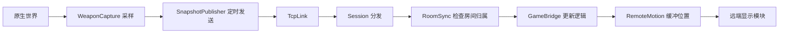

# RConnect 当前架构

> 2026-10-10，源码候选 0.2.23-dev；安装版仍为 0.2.22-dev。本文描述实际代码。
> 本轮调整与验证见 [架构整理记录](../state/architecture-2026-10-10.md)，此前问题清单见 [同步审查](sync-audit-2026-10-10.md)。

## 责任划分

| 模块 | 负责 | 不能代办的工作 |
|---|---|---|
| Session | 连接、身份、消息分发、原有 50 ms 定时器 | 不因收到玩家位置再制作一份主侧快照 |
| SnapshotPublisher | 从该定时器发送玩家状态、移动掉落；每约 200 ms 发送场景状态 | 不新增定时器，不判定伤害归属，不转移房间所有权 |
| RoomSync | 房间归属、版本标记、交接和旧房间请求结算 | 不绕过交接屏障直接复制新房间 |
| GameBridge | 游戏对象接入、原生代理、逻辑状态与显示状态的配合 | 不把冻结敌人的 AI/攻击重新运行一遍 |
| WeaponCapture | 观察真实开火、弹道、命中与魔法特效；制作发送数据并管理历史 | 不创建接收端特效，不对世界造成伤害 |
| UnitPresentation / ProjectileVisuals | 播放远端武器、敌人姿势和纯显示弹道 | 不开火、不生成奖励、不再次计算伤害 |
| RemoteMotion | 按源端时间缓冲位置与对应显示字段，处理暂停收敛 | 不推测尚未收到的位置，不延迟玩家自己的控制 |
| TerrainSync / WallImpactVisuals / ExplorationSync | 地形、墙上痕迹、探索各自的增量与确认 | 不接管原生门的动作字段，不改其它模组的视野规则 |

主侧保有共同房间的原生世界；分房时加入侧负责自己普通房间的原生模拟。远端玩家有可被原生敌人识别的化身。加入侧的共同房间敌人由镜像本体显示、受击代理参与原生命中与 SATS。代理共用本体的显示引用，因此遮罩与最终绘制处理仍有实际用途。

## 发送、接收与清理

玩家和搬运中物品沿原有 50 ms 定时器发送；敌人、门箱、地形等沿约 200 ms 场景期限发送；探索仍由自身约 100 ms 间隔控制。延迟的定时器不会补发一串过期快照。加入、离开时仍立即更新队伍名单。主侧没有队友时不制作无人接收的周期快照。

收到 playerstate 立即更新主侧所见队友，不再反过来触发主侧重采样。正常联机的 damage、loot、objs、terrain 只由 RoomSync.report 处理；拒绝的过期房间请求也在该处结束，不能落入另一套旧处理分支。伤害回执、拾取确认和房间交接仍保留各自的接受条件。

房间交接仍按“暂停 → 收齐旧房间请求 → 保存原负责人状态 → 分配归属 → 确认”推进。无人房暂停并保留敌人生命、门箱、破坏、奖励等本次联机进度。原生单位的重建、剧情房共同进入、宿主共同换图规则保持。

GameBridge 的房间显示资源统一从 resetRoomPresentation 清理：发送记录、接收特效、受击别名、遮罩、外观与运动/伤害基线。enterRoomBaselines 只登记当前房间身份并准备场景基线，角色交接不再先重置一遍又假装房间变化重置第二遍。会话级原生 AI 标志、注入单位和房间进度仍由各自的会话结束路径处理，不能随普通离房一起丢弃。

## 弹道历史的生命周期

- 离线时停止武器事件采样，连接模式变化时释放上一订阅的记录。
- 有发送方定时消费的玩家和主侧敌人，必须先把结束状态纳入快照，再保留 700 ms；定时器迟到不能提前丢掉最后一帧。
- 加入侧独立房间没有周期敌人接收方，保留活动弹道和最近 700 ms 的结束记录供交接，之后可退役。不能无限等待一个不会发送的确认。
- 已结束弹道不继续添加隐藏帧；原生图形已不存在的事件也能在被消费后退役。
- 轨迹沿用真实原生帧、原有 64 帧上限及接收端的源时间重放；没有换成简化的猜测弹道。

## 帧阶段与暂停

原生模拟之前进行房间门控、暂停及念力等控制；之后采样、移动镜像并推进显示；RENDER 在原生重建显示树后修正武器、衣服、遮罩和特效挂接。这些阶段仍保留原来的优先级，本轮没有把它们压成一个大回调。

共享暂停仍由 RoomSync 与 CoopPause 各自负责原来的字段。位置收敛到相同源帧，网络和界面继续工作；不能通过暂停整个收发循环代替原来的处理。

## 当前范围和剩余结构问题

本轮整理的是发送责任、源端/接收端武器呈现、缓存退役及房间清理。敌人身体/枪械的全部播放状态尚未与位置时钟统一；GameBridge 内仍有较多场景同步和诊断代码；高速搬运与常规场景同步的字段归属仍可继续收口。这些涉及可见行为，不在缺少针对性证据时一并重写。

支持范围仍是 1.02 的双人合作和同地图普通房分头行动。稳定重连、公共网络、更多玩家、其它游戏版本和新任务/交易系统没有因此成为已实现功能。实际线路通过 TcpLink 协商使用现有二进制消息编码并保留 JSON 回退；本轮不改变协议字段或安装路径。

## 验证入口

生产构建必须显式输出到新的 build 目录。冻结源、独立测试驱动、实际游戏/其它模组输入、存档和配置后，用实际候选字节运行双侧测试。新增 ArchitectureTestDoc 验证无消费者退役、迟到的消费者、原生图形消失以及重复发送；已有房间、伤害、门箱、暂停与视觉测试负责外部行为。

当前正式清单新增该组后为 48 组。构建、局部回归和性能测试各自记录，不能把源码整理或单次绿窗当成发布许可；只有固定发布门禁完成才能替换 release。
