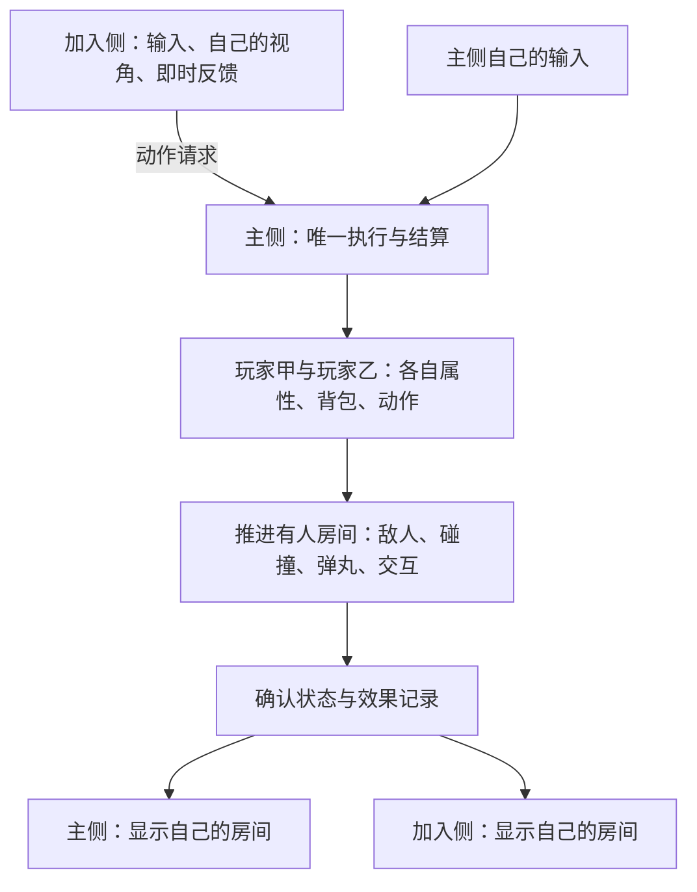

# 主侧统一执行：实现计划与 A/B 对照

日期：2026-10-11。状态：**架构方向已由用户选择；本文件是实施计划，尚未开工。** 本轮没有修改运行代码、编译、启动游戏或部署。地图修复支线按其另行收到的恢复指令继续。

用户已决定：新架构与现有架构保留为两个并行对照；**始终由主侧执行，分房时主侧同时运行双方所在房间**。以下“建议”是据此制定的工程安排，不冒充用户逐项确认的玩法变更。

[此前呈现方案与方案比较](remote-player-entity-plan-2026-10-11.md) · [原任务停点](../state/cooperative-hazards-2026-10-11.md) · [当前代码架构](architecture.md) · [地图支线](../state/map-generation-2026-10-11.md)

## 1. 用日常语言理解这次改造

把主侧理解为一张真正运行的游戏桌：桌上有两名玩家、敌人、子弹、门和掉落物。加入侧发送“我向右走、瞄准这里、按住开火”，主侧替这名玩家执行，决定到底射出几发、打中了谁、用了多少弹药。两台电脑再分别画出自己的视角。

分房时，主侧桌上同时摆着两个房间；加入侧不接管其中一个房间。两人汇合后只推进同一个房间一次。双方都离开的房间暂停，保留敌人死亡、伤害、破墙、门箱及掉落进度。



“主侧负责渲染”在这里指主侧生成正确的动作和效果依据。主侧不必替加入侧画完整屏幕、传视频；加入侧仍使用本地游戏资源绘制。即使主侧不显示第二个房间，那里的战斗也必须真实运行。

加入侧按键后若完全等待往返，会更迟钝。因此计划让视角、鼠标和经隔离的动作先在本机响应；主侧确认后把两者合并。**先响应不等于先认定命中**：伤害、拾取和正式资源变化仍等待主侧结果。

## 2. A 与 B 怎样并存

| 项目 | A：现有架构 | B：主侧统一执行 |
|---|---|---|
| 定位 | 可回退、可比较的现有实现 | 独立实验实现，逐阶段取得替代资格 |
| 玩家动作 | 沿现有归属与同步链 | 两名玩家的正式动作均由主侧执行 |
| 分房 | 现有房间负责人交接 | 主侧运行两个有人房间，无加入侧执行权交接 |
| 加入侧 | 仍保留原实现的执行职责 | 输入、界面、显示和受限预测 |
| 产物/配置/存档/日志 | 独立 | 独立 |
| 联机配对 | A 主侧 + A 加入侧 | B 主侧 + B 加入侧 |

### 2.1 三种记录，只有两条开发线

- **A0 安装锚点**：准确保存现在安装的 `0.2.22-dev` 字节、配置及依赖清单，作为回退依据。RConnect SWF 为 163453B，SHA256 `32602e77a21b206d1f7ff0e927b953878c28254e7201529455818923a3539732`。A0 是归档，不另养第三套架构。
- **A 对照候选**：现有架构收到公共修复后，形成新的不可覆盖快照。每次比较写清所用 A 的版本，不能把后来修过的 A 仍称为原安装字节。
- **B 对照候选**：与指定 A 使用相同的公共修复、外部模组、角色和场景输入；另列新架构自身的差异。

未完成的 `probe-cooperative-56 / 8f02fef5…` 是开发停点，拆雷、地图及旧压力/火焰问题仍有失败记录，不能把它称为完整正常基线。A 本身有缺陷时，记录“旧缺陷/新缺陷/两者相同”，不把对照理解为 A 的所有表现都正确。

### 2.2 源码与运行目录隔离

遵守本仓库现有 **master 单分支直提**纪律。两条版本线通过独立源码入口、显式构建目标和冻结产物区分，不在本轮创建分支或切换工作树。下列目录名是规划，尚未创建：

```text
mods/RConnect/
  src/                              A 的现有入口和实现
  experimental/host-authority/
    src/                            B 的入口和实现
    native-patches/                 B 所需原生补丁的源与清单
  tools/host_authority/              B 的构建、隔离运行与对照编排
  build/ab/<comparison-id>/
    manifest.json                   本轮配对的全部输入与有意差异
    A/                              A 冻结源码、产物、运行目录、证据
    B/                              B 冻结源码、产物、运行目录、证据
```

初期不为共享而搬动 A 的核心。已证明无执行归属的编码、数学、外观资源等可以复用；确有重复维护成本后，才提取双方使用的小型公共代码，并重新验证 A。B 不从 A 的大桥接类继承整套业务后再关闭一半分支。

每个独立运行目录内部仍满足 loader 契约：`mods/Rconnect/release/RConnectMod.swf`、同名入口类及配置路径保持原样。A/B 在目录外层、窗口标题、HUD 和清单中明确标识；不能仅把文件改名为 `RConnectB.swf` 并期望旧 loader 加载。

构建必须显式写入新 `build` 目录。两套代码不会由默认构建一起打包；同一会话也不会同时启用新旧两条攻击或显示路径。

### 2.3 用户以后怎样试用

达到可玩检查点后，提供“A：现有版”和“B：实验版”的独立启动入口，每次选择一套双人组合。角色测试档从同一模板复制，之后分别保存；A/B 不共用可写存档，也不轮流覆盖正常安装目录。

每次自动测试使用新的 AIR AppID、日志目录和成对端口。端口分开之外，连接握手还核对架构类型、协议版本、原生补丁能力和会话身份。A+B 或不匹配的 B 版本在载入联机世界前明确拒绝，不静默退回旧算法。AppID 遵守 AIR 字符限制。

并行保留两个版本，不表示性能测试同时运行四个游戏实例。测量按 A+A、B+B 轮流进行；用户原游戏和其他程序保留，资源噪声如实记录。

## 3. 谁负责哪些事情

| 事情 | B 的主侧 | B 的加入侧 |
|---|---|---|
| 移动与碰撞 | 确认实际位置、速度、受击与抓取约束 | 采集输入；对自己的移动作有限预测并校正 |
| 开火、换弹、魔法、投掷 | 检查资格，执行原生规则，消耗资源 | 发请求；播放可预演反馈与已确认效果 |
| 伤害、护甲、状态、死亡 | 对两名玩家和敌人唯一结算 | 更新本机 UI/角色镜像，不再扣第二遍 |
| 敌人、炮塔、地雷、弹丸 | 在对应有人房间运行 | 接收并显示；不同时运行另一套 AI/伤害 |
| 门箱、破坏、拾取、奖励 | 检查距离/目标/归属，执行并编号 | 发交互请求；显示动作和确认结果 |
| 暂停/SATS | 确定冻结帧和恢复帧，管理两人的执行队列 | 选择目标、发队列与暂停请求，显示同一冻结状态 |
| 镜头、鼠标、聊天、个人浮窗 | 本机自行处理 | 本机自行处理 |
| 换图与剧情 | 保留宿主共同旅行、剧情挑战共同进入规则 | 普通房可独行；跨地图出口沿现有提示规则 |
| 保存 | 本次联机中维护确认账目 | 收到确认后映射回自己的角色，由自己保存 |

“移动最终由主侧确认 + 加入侧本地预测”是本计划为实现完整主侧执行采用的工程建议。若以后只接管攻击而保留加入侧最终位置权，需要明确另记为混合方案；本计划不在实现中默默退回该方案。

需要向主侧复制**执行所必需的本次联机角色资料**：装备实例、弹药/消耗品、魔力/AP、护甲、技能修正及状态，并处理换装、消费、拾取后的确认。这不新增互看背包、交易或任务同步玩法，但确实是新架构不可省略的内部工作。

联机时，角色菜单中会改变上述资料的动作也要走确认入口；不能让菜单先在加入侧改一次、主侧再扣一次。角色导入/回写用受控数据与版本号，不传 AS3 对象指针或整棵显示树。普通奖励、经验、存档点继续遵守已选规则；不引入跨退出的完整随机房战斗存档。

## 4. 原版必须改造的三个地方

### 4.1 两名完整玩家不能共用一套全局资料

原版 `World.w` 持有单份 `gg/pers/invent/ctr/sats/loc`。`UnitPlayer.attach` 会把这些属性和背包的 owner 指向自己；`Weapon` 玩家路径还会将持有者强制转成 `UnitPlayer`。`WMagic` 直接访问全局魔力，`WThrow` 直接用全局房间放置地雷。

主侧因此需要独立的 `PlayerContext`（每个玩家自己的资料包）及能执行原生动作的 `PlayerActor`（真正参加战斗的角色）。优先验证与 `UnitPlayer` 类型兼容的隔离实现；不直接复用当前 `RemoteDamageUnit` 并把 `player=true`。

原生访问优先改成按 owner/目标/房间查上下文。确实暂时只能借用全局引用的局部调用，必须有集中、嵌套安全的切换与恢复，以及异常检查；异步回调、事件监听、子弹后续 step 需要保留自己的归属。**不能以一次 try/finally 切回成功，推断未来回调也隔离了。** 镜头和本机 UI 的玩家引用长期保持本机角色。

两人同房时，敌人感知、炮塔目标和地雷触发必须枚举合法玩家，不能继续只看 `loc.gg` 或轮流改 `World.w.gg` 来碰运气。伤害入口识别实际受害者，不再沿 A 的“转给角色所属端后重复执行原生伤害”链。

### 4.2 房间更新要与本机画面更新分开

原版 `Location.step()` 开头调用一次 `gg.step()`，再推进对象链，同时做鼠标目标、照明等显示工作；`stepInvis()` 不推进玩家且内容也不完整。`Land.step()` 还包含上一房间过渡及全局脚本。

所以不能把 `World.step()` 调两次，也不能把任意后台房间的 `stepInvis()` 当作完整战斗。计划把“房间里的模拟”和“本机可见房间的显示”拆开，清楚登记对象由谁推进，防止第二玩家既被单独推进、又在 `firstObj` 中推进一次。

### 4.3 加入侧保留显示能力，切断重复业务

加入侧仍需原生身体、武器、SATS 目标和场景资源。但输入要在本机原生攻击/消费/拾取产生副作用前转成请求；敌人、陷阱、持续伤害区也不能继续独立结算。

房间加载时，以主侧给出的实体身份绑定或接管原生模板；避免“原生自己生成一批活敌人，再叠加一批网络镜像”。身体、武器、护盾、念力和弹道归同一显示实体管理。已有原生资源、翻转与挂点算法经过核对后保留。

主侧的执行实体已有原生身体，本机显示使用它，不再额外叠一具网络身体。加入侧则由显示实体承接确认结果；保留 UI 所需引用并不意味着恢复整套原生世界步。双方每个身份都只有一具可见身体和一条生效的业务链。

这是原生适配工作，可能需要游戏 SWF 补丁，不能预先承诺只改模组 SWF 即可完成。补丁先在本模组的隔离副本上验证，保存输入指纹、源差异和类/标签审计；正式游戏文件修改按当时明确授权及发布门禁处理。`game-reference` 继续只读。

## 5. 模块划分：把复杂性集中在少数入口内

以下是职责与接口草案，不是已经创建的类，也不要求每一行都拆成独立文件。

| 模块 | 对外只需要知道 | 内部负责解决 |
|---|---|---|
| `SessionProtocol` | 接收输入、发送确认帧、连接/离开 | 配对检查、身份、顺序、去重、编解码与队列上限 |
| `HostSession` | 加入/退出、提交请求、推进一个世界步 | 两个玩家、暂停、跨房变更、资源/动作确认的固定顺序 |
| `PlayerActor` | 用某份输入推进、读取确认状态、销毁 | 原生玩家/装备、独立资料、受伤和动作生命周期 |
| `RoomRuntime` | 激活/暂停房间、转移角色、推进一次 | 房间对象、敌人感知、地形、稳定身份、无人房保留 |
| `NativeAccess` | 按角色/房间访问原生功能 | 集中处理全局引用、类型限制、原生补丁与已明确模组接入 |
| `ClientReplica` | 应用确认帧、接受本机输入、呈现/清理 | 自己的预测与校正、他人的插值、统一效果时间和生命周期 |

数据契约由双方共用，运行期对象不跨进程共享。界面只读状态或提交动作，不直接改房间集合、创建弹丸、扣血。测试从同一接口提交输入、观察确认结果；必要的原生诊断留在内部，避免调用者了解几十个补救开关。

A 的 `GameBridge/RoomSync` 原样留作旧实现。B 可借用已经验证的坐标、资源识别和状态编码，但不保留 `RoomSync` 的“分房后加入侧成为执行者”分支。每迁移一条职责，B 内只保留一个真正生效的入口；A 由版本归档保留，不变成 B 内永久兜底。

## 6. 动作请求、执行结果与时间

### 6.1 传“玩家想做什么”，传回“实际发生了什么”

| 类别 | 示例 | 处理规则 |
|---|---|---|
| 连续输入 | 左右移动、瞄准坐标、开火是否按住 | 有序输入样本；按武器原生规则产生连续发射，避免每个网络包等于一发 |
| 一次动作 | 换弹、换枪、使用物品、抓/放、交互 | 独立请求编号；确认接受、拒绝或完成；重复不再消费 |
| 确认状态 | 位置/速度、动作阶段、资源、装备、目标关系 | 主侧模拟帧号和已消费输入序号；迟到状态不能倒退新代次 |
| 确认事件 | 实际发射、命中、爆炸、门动作、拾取 | 动作/发射/弹丸/效果各自稳定身份和主侧时间；区分需保证的业务与短时视觉 |
| 完整状态 | 初次加入、进入房间、发现数据断层 | 原子应用当前实体及活动效果清单；不借补状态重发旧伤害/奖励 |

共同身份至少包含：会话、玩家、探险/房间、出生代次、装备代次。子弹还需要发射和颗粒身份；复活后的玩家与死前即使名字相同，也不接受对方的旧输入。B 不沿用房间“执行权租期”；只保留拒绝旧房间消息所需的房间状态代次。

主侧玩家也从相同的动作入口进入，只省略网络传输，避免两套射击规则。加入侧提交的是瞄准/操作意图，不自行宣告“我造成了多少伤害”。主侧按实际原生执行记录发射与命中，再分别发给需要显示的客户端。

### 6.2 一次原生世界步的目标顺序

1. 收取输入，处理连接/资料/换房请求；暂停切换在明确帧边界提交。
2. 按稳定顺序给两名玩家准备各自输入与上下文。
3. 对有人房间的去重集合各推进一次；房内玩家、敌人、弹丸和触发器各一次，沿已审计的原生阶段顺序工作。
4. 汇总资源和交互结果，生成带帧号的确认状态与事件。
5. 更新本机镜头/界面；发布网络数据。全局脚本、自动保存和计时只推进一次。

保留原版按步计时的含义；不能把当前约 50ms 的网络采样周期当成新的物理时步，也不为追赶消息对同一实体无限补跑。长帧时显示等待、模拟延迟和发送队列分别记数，不用静默漏跑加入侧房间来换取好看的主侧帧率。

消息队列有明确上限和过期处理。发送前可合并可替代的最新显示状态；有因果关系的输入、离散动作和确认不能随意丢弃。持续输入失效/断开时释放开火和抓取等状态，不能永久沿用最后一次“按住”。不以重放秒级过期操作解决积压。

### 6.3 加入侧先响应，再与主侧对齐

- 鼠标、镜头、选中提示立即本地处理。
- 自己移动保留未确认输入。收到确认后，从已确认位置对尚未处理的输入作有界重放；只预测自己的运动，不重跑敌人、伤害、拾取和奖励。地形版本改变时丢弃无效预测前提。
- 举枪、后坐、枪口和声音逐类验证后允许预演。确认记录将预演与对应动作关联，不能再播一次。拒绝时撤销可撤销视觉并更新状态；已播放声音无法倒放，这项误反馈单独统计。
- 首期不预测正式弹丸命中、随机散布结果、追踪路线和持续伤害。普通视觉弹丸是否值得预测由手感实测决定，不能用复制原生 `attack` 来实现。

原型按**主侧实际执行时的世界**计算命中，不新增回到历史位置判定命中的机制。加入侧看到的敌人通常略早，因此“眼中打中、主侧未中”的感知差仍需测量。统一执行并不会消除往返和显示缓冲；若影响达到不可接受程度，B 停留实验阶段，不能靠预测画面伪称已解决。

## 7. 主侧怎样运行两个房间

### 7.1 房间保留规则

房间身份沿用经过验证的完整原生位置标识，并包含本轮探险身份、前/后景及隐藏房身份。不能只按地图名或平面坐标定位，否则同名新探索、背景门和旧房状态会串到一起。

| 房间状态 | 主侧做什么 |
|---|---|
| 两名玩家同房 | 一个房间实例、两个玩家；房间物体只推进一次 |
| 两名玩家分房 | 两个房间实例各推进一次；敌人/炮塔/地雷在各房感知相应玩家 |
| 最后一人离开 | 在一步结束时冻结完整本次会话状态；保留活动对象和计时，不结算离线战斗 |
| 第一人回来 | 激活保留状态；首次才生成，重访不重新生成已杀敌人 |
| 进入新探险 | 新探险身份；生成新世界，不误用上一轮房间缓存 |
| 全队换图 | 主侧提交共同旅行；旧图输入失效，新图准备好后统一确认入场 |

无人房初期优先保留已驻留原生实例及房间账目，先证明语义正确；再按实测内存决定是否需要序列化冷房间。不能直接调用带重置敌人副作用的原生卸载作为省内存捷径。驻留内存随探索增长是明确风险，必须纳入长局门槛，不能把“等以后优化”当作完成。

### 7.2 背景门和跟随

角色转房作为一次完整变更：检查出口 → 确认目标房间 → 从旧房退出 → 加入目标房 → 回报新的身份和位置。旧房消息不再驱动该角色。加入侧换房不替换宿主的 `World.gg`、摄像目标或 UI 资料。

跟随模式是另一名玩家随后提出的转房动作；需要验证出口与到达状态，不能通过把对方引用设成本机玩家来“跟随”。剧情/挑战仍共同进入；不完整的任务同步不借普通房改造偷偷纳入。

### 7.3 离屏不等于什么都不更新

后台房间可以不做最终屏幕合成、摄像机、鼠标悬停和非必要声音输出，但武器挂点、原生 MovieClip 帧、碰撞形状等若影响真实发射，仍须正确推进。先验证这些依赖，再关闭纯显示开销。

主侧只把加入侧所需房间的数据发给它，避免广播全地图每个对象。地图定义和种子以主侧为准；仅同步种子不能替代对原生版本、生成参数及实际布局一致性的核对。

## 8. 画面同步与暂停不能留到最后补救

身体、枪、弹丸、护盾、念力、敌人姿态和门箱动作都使用同一主侧时间坐标；远端显示在一个明确的播放时刻取样。自机预测单独标记，不能混作确认状态。

两台进程的本地计时器不能直接相减当延迟；通过主侧帧号、输入确认和测得的时钟映射对齐，并记录估计误差。远端显示初期复用已验证的缓冲/插值规则，调整等待量必须配对实测；自己的移动预测不自动推广为敌人或追踪弹的无界外推。

- 枪械：同一动作时刻的身体、瞄准、翻转和枪口；发射从当时枪口产生。
- 连续效果：光束/闪电的实际端点、形状与结束；酸液/燃烧的生命周期；不能只传“正在攻击=true”。
- 附着效果：护盾形态/透明度、隐身可见程度、念力施法者与目标关系，由所属显示实体统一创建和解除。
- 门箱/掉落：传开始时刻和阶段，按时间连续播放；物品落地和拾取业务仍来自主侧。
- 敌人：位置、活动/休息/开火姿态与武器也进入统一时间合同。此次 B 接管全部执行，因此不能只统一玩家而继续沿用敌人的混合播放时钟。

共享暂停用一份主侧确认的冻结帧。申请时加入侧可先停本地反馈并提示等待，收到最终冻结状态后，身体、武器、特效和 SATS 选择目标一起对齐。冻结期间网络/聊天/选择队列继续，模拟不走；所有暂停原因解除后，从该帧恢复，丢弃旧播放积压。

SATS 的准星、命中预览和目标轮廓引用同一冻结实体及其代次，不能同时留一具原生目标和一具网络目标。AP 预留与实际消费分开：各玩家独立队列，主侧原生动作实际执行时扣除，拒绝/死亡/换房时正确清理。沿用原生费用规则，不在重构中顺便修公式。

## 9. 特殊能力的迁移清单

普通枪通过只证明最短通路。每类都要覆盖两名玩家、左右/上下极限角、移动中使用、同房/分房、暂停/死亡/离房清理。

| 类别 | 主侧必须真实执行 | 两侧必须正确显示 |
|---|---|---|
| 普通枪、霰弹、连射 | 散布、射速、弹匣/换弹、命中 | 翻转、枪口、每发轨迹、命中特效及伤害数字 |
| 近战、追踪弹 | 挥动阶段、目标、碰撞/追踪 | 同一挥动和实际轨迹；离开武器后弹体仍存在 |
| 魔法、光束、闪电 | 技能/魔力、连续伤害、真实端点 | 原生形状、频率、停火、命中效果 |
| 投掷物、酸性炸弹 | 投掷、落点、爆炸、持续区 | 飞行、爆炸、酸液持续时间；无重复结算 |
| 玩家地雷/场景地雷/炮塔 | 布设者、发现、触发、拆除、目标和友伤 | 加入侧探索可见；敌我关系一致；已销毁者不复活 |
| 念力物品/敌人/队友 | 抓取资格、约束、投掷和释放 | 双方光晕和运动；松手能换目标；许可和挣脱开关 |
| 护盾、隐身、燃烧 | 原生状态与战斗修正 | 正确原生资源、颜色透明度、隐约可见及清理 |
| MSW 非致命激光/激光笔 | 现有已选友伤/影响规则、MSW 参数 | 短暂视野受限，持续时间正确，玩家保留控制 |
| 容器、奖励、存档点 | 单份掉落/领取账目，经验双方奖励，共同解锁 | 双侧掉落和交互动画；各自保存角色 |

未知第三方效果没有“用了完整玩家便自动兼容”的保证。先整理已安装且既有功能依赖的访问点，优先用现有公开规则和结果接入。对其他模组新增接口/修改超出已有授权时，另拿具体补丁协调；本计划不扩展 RV 既有局部授权。

## 10. 实施顺序与每阶段的交付

顺序按最可能推翻可行性的风险排列。先验证双玩家和后台房间，再批量迁移武器。下表不承诺日历工期；阶段未过时只修该问题或记录停点，不靠缩掉分房功能宣告成功。

| 阶段 | 具体交付 | 必须拿到的证据 |
|---|---|---|
| B0 冻结对照与契约 | A0 归档；第一对 A/B 输入清单；B 独立构建/启动入口；请求和状态格式 | 安装及用户存档未变；配对错版本拒绝；差异可追踪；原失败完整保留 |
| B1 两名独立玩家 | 主侧中有两个可执行原生动作的玩家，各自输入/装备/属性；一支真实普通枪贯通 | 一人换弹/受伤不改另一人的背包/护甲/魔力；敌人能分别瞄准；一次消费、一次伤害；确认能驱动加入侧显示 |
| B2 两个有人房间 | 主侧房间调度、原子转房、普通门/背景门、无人房冻结；提前用魔法与投掷探查全局依赖 | 两房同时战斗，汇合不倍速；宿主镜头不变；重访不刷回敌人/破墙；地雷不会生成到错误房间；全局计时不翻倍 |
| B3 手感和统一时间 | 自己移动预测/校正、射击反馈认领、统一玩家/敌人/效果播放与暂停 | 接受/拒绝/迟到不双播；持续输入能停止；SATS 单一目标/同帧冻结；恢复无旧帧补播；记录真实与显示延迟 |
| B4 既有功能迁移 | 完成第9节矩阵与角色资料确认/保存适配，移除 B 中旧结算出口 | 双向伤害/友伤/念力/奖励/特殊武器全部走同一负责端；无互串资料、重复拾取或不可见业务 |
| B5 完整 A/B 验证 | 相同条件回归、压力与长局、正常无驱动加载；可供用户比较的独立测试版 | 原有可用能力不倒退；既有门槛和新增必需检查通过；热点/内存/队列趋势可解释；失败无覆盖 |
| B6 用户试用与收口 | 两套明确标识的启动入口、变更/限制清单、整套回退；获准后才考虑替代正式安装 | 用户实际手感比较；最终字节门禁；需要原生补丁时按整套产物核验/回退 |

**恢复实施后的第一交付定为 B0+B1。** 这是技术原型，不标成可替换 A 的候选。B2 是用户所选路线必须跨过的第二道检查点，不延迟到做完所有特效之后。

B1 的关键反例：主侧使用高护甲/少弹药角色，加入侧使用低护甲/另一种弹药角色；分别换弹、受伤、换枪和射击，再交换角色重复。若只是两人装备相同，很容易把共用背包/属性的错误测成通过。

实施过程中若 B2 证明后台房间或第三方依赖难以隔离，保留 A、提交可复现的失败与实际替代方案；不能未经决定把 B 改成必须同房、让加入侧偷偷运行房间或减少既有特殊武器支持。

## 11. 怎样公平比较两个版本

### 11.1 每一对比较固定哪些东西

记录 A/B 产物、源码提交/未提交补丁、编译工具、原生 SWF、全部其他模组和配置、原生资源、角色模板、难度、地图定义/种子、测试驱动、显示设置及运行参数的指纹。记录输入时序和实际执行事件，不能仅写“同一张地图”。

地图修复是公共变化，完成验证后进入配对双方；若只进入 B，只能报告“整体版本差异”，不能归因架构。地图支线目前在 `build/m51/integration-baseline-0.2.22-map-wallblend-20261011` 做专项诊断；它不是 B 基线，也不能直接当正式发布基线。

B 需要原生补丁时，补丁是**有意差异**。若补丁在 A 模式下能证实不改变行为，可让配对 A 使用同一底座；否则在报告中列明 A 原底座/B 新底座，并增加针对补丁的隔离对照。不能为写“相同输入”隐瞒原生差异。

比较有两种问题，分别回答：

1. 和准确安装 A0 比，整个 B 候选体验怎样？这是版本总体比较。
2. 公共修复和外部条件相同时，A 与 B 的差异怎样？这才用于判断架构收益。

### 11.2 测什么

| 维度 | 观察内容 | 不能用什么替代 |
|---|---|---|
| 正确性 | 实际原生发射/命中、弹药/HP、唯一掉落、前后景与生死身份、资料不串 | 只收到一个网络包、画出一条线 |
| 连续性 | 身体/枪口/轨迹误差、动画最长停顿、敌人阶段、暂停前后位置与效果 | 单张好看的截图 |
| 自机响应 | 按键至首次反馈、至主侧执行、至收到确认；预测纠正次数/距离 | 只测先播的枪口动画便称零延迟 |
| 主侧负载 | 同房与双房的帧耗时分位数、模拟步完成率、各房实际推进次数 | 只测空房或让后台房漏步 |
| 传输/播放 | 每秒消息与字节、队列最大年龄/长度、显示时差、无消费者时的开销 | 只比包数、代码行数或文件大小 |
| 长局 | 房间驻留、弹丸/效果/监听器数量及内存趋势，反复出入/复活/暂停 | 8秒压力通过便称长局稳定 |

覆盖场景：静态瞄准和极限翻转、移动连射与密集弹丸、快速念力、容器落物、两房各有敌人/炮塔/地雷、背景门往返、死亡复活、双端交替 SATS、共同旅行、新探索与重访。

短场景按成对重复、交替 A/B 顺序测量；先冻结场景、预热、采样时长和重复数，再看 B 结果。长局单独测试。已有误差/暂停/原生速率门槛保留，新增主侧双房负载和预测指标在 B0/B1 取得可重复 A 分布后设定并冻结，不能按 B 的成绩倒推门槛。系统负载波动无法排除时报告证据不足。

### 11.3 保留旧测试目标，替换失效的驱动入口

当前正式清单已登记为 51 组，以冻结时的精确清单为准。老测试若直接调用加入侧原生 `attack`，它已绕开 B 的请求路径：保留同一玩法与结果断言，给 A/B 各自合适的输入适配器，不能要求 B 恢复本机实际开火来迎合旧夹具。

先做固定输入回放检查身份、去重、时间、顺序与清理，再用原生双实例检查真实资源/命中/画面和负载。固定回放、编译成功、专项诊断都不能替代最终实机门禁。

新增必需检查：重复请求、迟到旧出生/房间事件、缺少松手/失联、主侧拒绝动作、两个暂停原因、两玩家不同资料、同房不双步、分房都推进、SATS 目标唯一、确认后预演不重播、A/B 错配拒绝、无人房内存与重访进度。

## 12. 风险、回退与当前停点

| 风险/尚未实证的假设 | 影响 | 处理与停止条件 |
|---|---|---|
| 原生/模组逻辑过度依赖唯一 `World.w.gg` | 串属性、错房间、玩家失控 | B1/B2 优先查证；无法隔离就保留失败和 A，不扩充功能凑演示 |
| 同机双房让主侧更慢 | 两端都更卡 | 单房/双房分别配对测；优化纯显示与采样，不能削掉后台战斗 |
| 请求往返使自机迟钝、预测常被纠正 | 画面快但操作感更差 | 分开量即时反馈/真正确认；不可接受则不替换 A |
| 漏采特殊效果 | 仍有缺动画、错光束或酸液 | 第9节逐类实测；完整玩家实体不等于自动支持全部效果 |
| 保留房间占用内存持续增长 | 长局退化/崩溃 | 先量每房和累计成本；需要序列化时单独验证存取完整性 |
| 菜单、保存或 UI 又执行一次业务 | 物品复制/丢失、双扣伤害 | 联机期唯一确认出口；角色回写可追溯，用户原档隔离 |
| 公共修复/外部模组在测试中变化 | A/B 结论失真 | 保护清单校验失败则新建配对基线，旧失败不覆盖 |

回退是停止 B 会话并用 A 的完整运行套件重新开始测试。若 B 含原生补丁，只换一个模组 SWF 不是完整回退。A/B 不热切换正在战斗的世界，也不尝试无证明地互读对方运行期检查点；这轮不做稳定重连/热迁移。

当前只完成规划、源码核对与记录；未创建 A/B 启动器，未实现双玩家隔离或后台房间，也没有新性能数据。安装仍 `0.2.22-dev`。原地图/拆雷/压力/火焰失败继续登记，原 HTML 图解仍描述“呈现收口”旧方案，不作为本新架构预览或实测。

保持原排除范围：公网、稳定重连、三人以上、其他游戏版本、新任务/交易/互看背包玩法。暂停的旧修复不自动全部恢复；地图支线的单独授权也不等于本方案开工。

## 13. 核对依据与接续入口

以下为本地源码和既有记录，支持的是现状与风险判断，**不是 B 已可运行的证据**。行号用于导航；地图支线正在修改的工作树不当成已冻结实现。

- [World 全局引用](../../../game-reference/decompiled/1.02/src102/scripts/fe/World.as:34)、[世界步](../../../game-reference/decompiled/1.02/src102/scripts/fe/World.as:1227)。
- [玩家 attach](../../../game-reference/decompiled/1.02/src102/scripts/fe/unit/UnitPlayer.as:401)、[玩家控制](../../../game-reference/decompiled/1.02/src102/scripts/fe/unit/UnitPlayer.as:2077)。
- [原生枪械执行](../../../game-reference/decompiled/1.02/src102/scripts/fe/weapon/Weapon.as:1421)、[换弹资源](../../../game-reference/decompiled/1.02/src102/scripts/fe/weapon/Weapon.as:1714)、[原生动画](../../../game-reference/decompiled/1.02/src102/scripts/fe/weapon/Weapon.as:1966)。
- [魔法的全局属性依赖](../../../game-reference/decompiled/1.02/src102/scripts/fe/weapon/WMagic.as:21)、[投掷的全局房间/资料依赖](../../../game-reference/decompiled/1.02/src102/scripts/fe/weapon/WThrow.as:127)。
- [Land 调度](../../../game-reference/decompiled/1.02/src102/scripts/fe/loc/Land.as:1567)、[Location 隐形更新](../../../game-reference/decompiled/1.02/src102/scripts/fe/loc/Location.as:3302)、[Location 正常更新](../../../game-reference/decompiled/1.02/src102/scripts/fe/loc/Location.as:3348)。
- [共享库的主循环/输入/SATS/保存核对](../../../shared-knowledge/ui-systems/discoveries/runtime-loop-input-save-source-audit-2026-09-09.md)、[玩家驱动](../../../shared-knowledge/entities/facts/unitplayer.md)、[原生对象容器](../../../shared-knowledge/world-objects/facts/object-containers.md)。本轮局部复核与这些记录相符，不重复创建知识条目。
- [现有远端单位](../src/rconnect/game/RemoteDamageUnit.as)、[远端运动时间](../src/rconnect/game/RemoteMotion.as)、[武器显示](../src/rconnect/game/WeaponDisplay.as)、[房间归属](../src/rconnect/core/RoomSync.as)。
- [M51 检查清单](../tools/validation/run_final_regressions.py)、[当前记忆](../state/MEMORY.md)、[开发日志](../state/journal.md)。
